<h1> <code>PDFr</code> &nbsp; <sub><sub><code>com.karako.pdfr</code></sub></sub></h1>

📱 PDF reader for Android.

<hr/>

## 👀 Privacy

- 🚫 no network permission.
- 🛑 no ads.
- 📉 no analytics.
- 🔒 no data collection.
- 🗂️ documents are copied into the app's private cache only while they are open.

<hr/>

## 👇  download (direct URLs - latest release)

- [app-arm64-v8a-release.apk](https://github.com/eladkarako/pdfr/releases/latest/download/app-arm64-v8a-release.apk) - about ~16MB (new devices)
- [app-armeabi-v7a-release.apk](https://github.com/eladkarako/pdfr/releases/latest/download/app-armeabi-v7a-release.apk) - about ~12MB (old devices)
- [app-x86-release.apk](https://github.com/eladkarako/pdfr/releases/latest/download/app-x86-release.apk) - about ~17MB (32bit emulator)
- [app-x86_64-release.apk](https://github.com/eladkarako/pdfr/releases/latest/download/app-x86_64-release.apk) - about ~17MB (64bit emulator)
- [app-universal-release.apk](https://github.com/eladkarako/pdfr/releases/latest/download/app-universal-release.apk) - about ~60MB (everything in one APK, best if you need to install on multiple platforms, otherwise choose the first one `app-arm64-v8a-release.apk`)

- [output-metadata.json](https://github.com/eladkarako/pdfr/releases/latest/download/output-metadata.json) - release information.
- [changelog.txt](https://github.com/eladkarako/pdfr/releases/latest/download/changelog.txt) - latest list of changes.
- [version.txt](https://github.com/eladkarako/pdfr/releases/latest/download/version.txt) - latest version.


<br/>
<br/>
<hr/>

<details><summary><h2>📱 screenshots (click to see larger screenshot)</h2></summary>

### classic buttons (like in Windows 98)

clear and accessible, you won't wonder if a word is clickable with those buttons, and they are everywhere across the app (including dialogs).

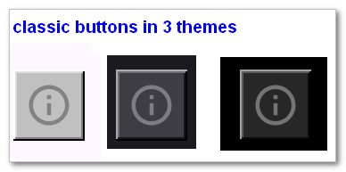

<hr/>

### main

simple, clean, straight-forward, accessible interface.

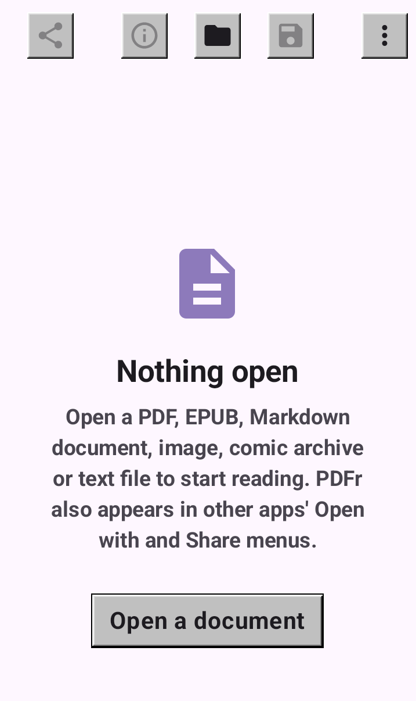

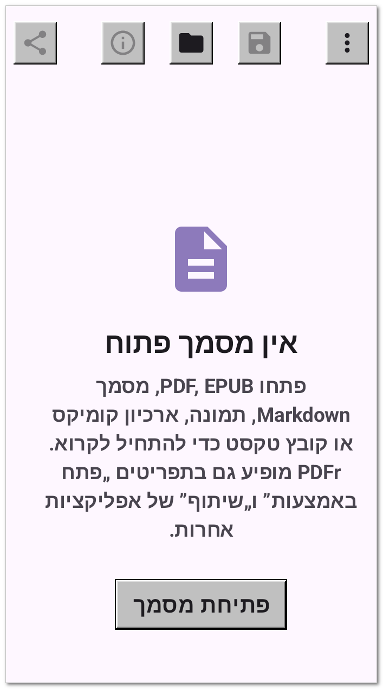

### menu

some are available only for PDF, and TIFF (formats with pages).

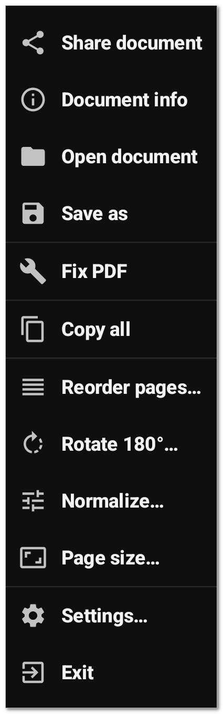

### fixing PDF

this is a feature that is available even before reading a file,  
since sometime you won't be able to open a corrupted PDF file,  
if you haven't opened an actual file, you'll be asked to choose from the storage the file to fix,  

other entries will be grayed-out/disabled until you'll open a file.  

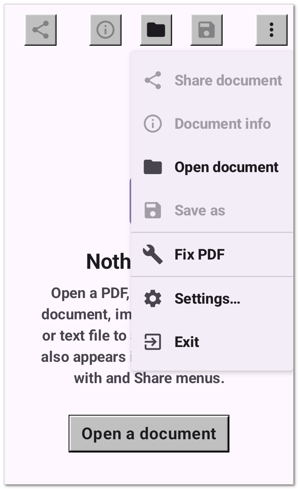

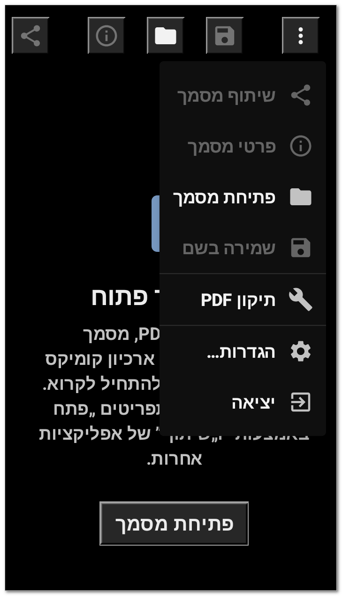

<hr/>

### "i" - view and modify meta-data

file, as well as document properties when available.
few common ones are shown (even if empty) so you'll be able to easily add them.

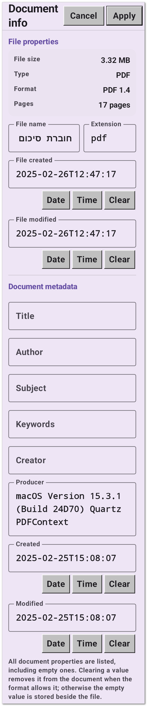

you can enter the date-time signature manually or use the button below (every date-time related meta-data)  
to set it with ease.

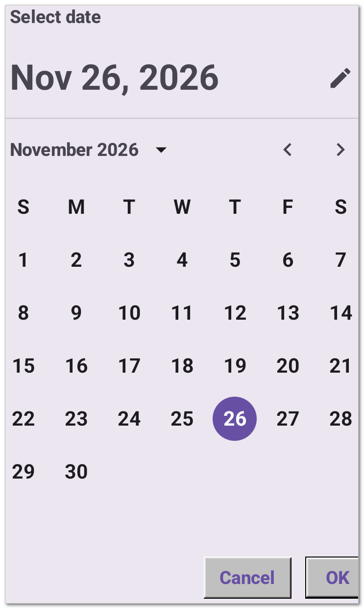

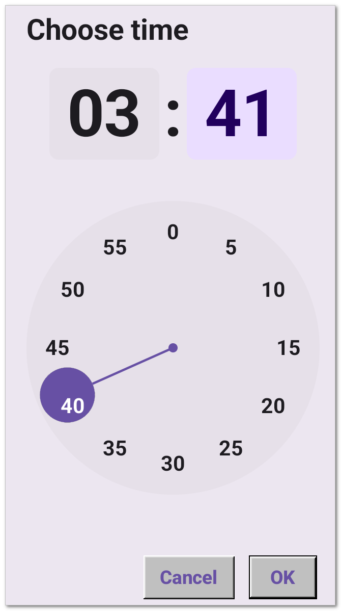

for file properties and meta-data that are date-related,  
the timezone is pre-calculated from the file, stripped and shown as your device's timezone,  
when you edit any of the date-time related properties or meta-data,  
the values are converted to UTC, and stored like this.

you can easily remove private information from pictures, and pdf with this feature, as well as fix missing values.

<hr/>

### settings

you can override the language and the toolbar directions through here

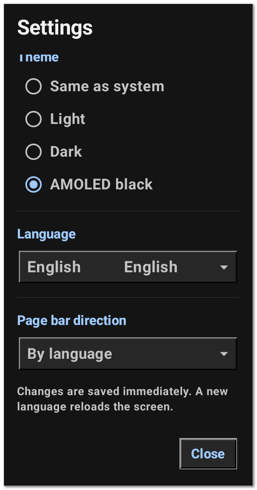

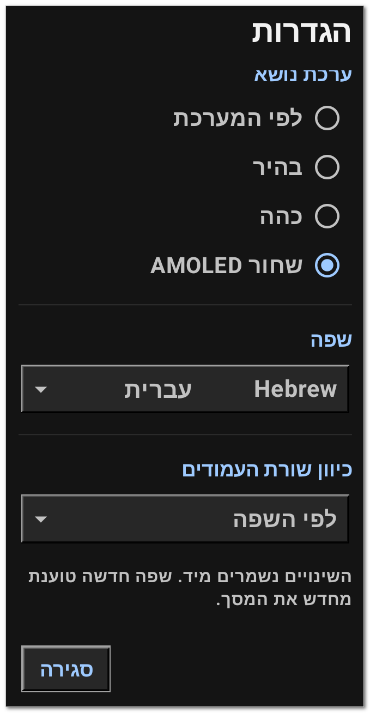

<hr/>

### current page number, total page number is a static toolbar

- the order `current page`/`total` can be switched through settings,  
by default it will match the language, if your language is left to right, by default is on the left.
- the current page input gets updated as you scroll, and you can manually edit the number and click the "ENTER" on your device's keyboard, or click the little button next to it to jump to that page ("goto").

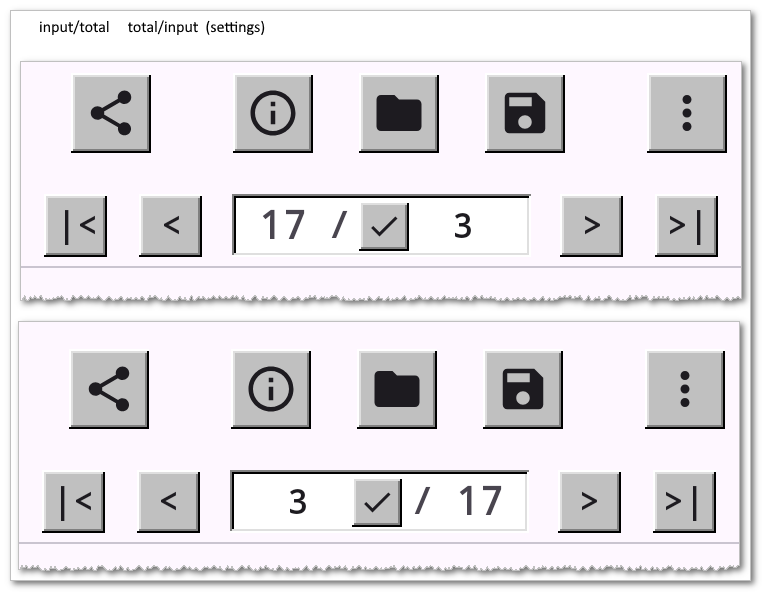

<hr/>

## modifying the PDF (!)

`PDFr` (with `MuPDF` and `qPDF`) allows you some very useful PDF modifications,  
those are not "presentation-only" it creates a new PDF with your modifications, which you can share, email, print,...

### 180° page rotation, with range. 
this is very useful if you've scanned or received a PDF that is upside-down. you can specify the exact range to rotate, leaving other pages unchanged. this only shows in file format that have pages such as PDF (and sometimes TIFF).

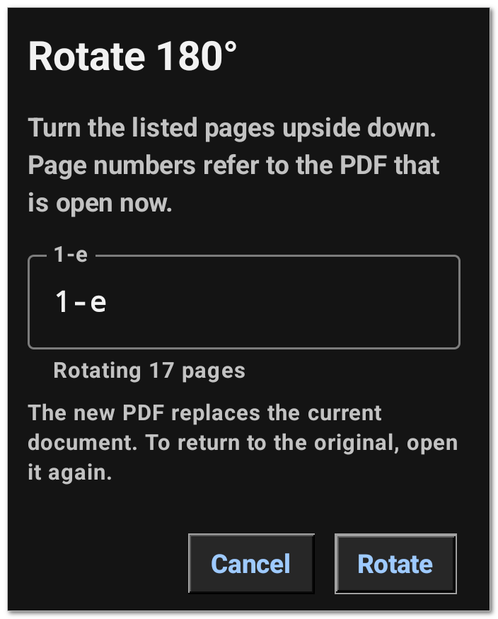

<hr/>

### page re-order.
you can delete page, duplicate pages, and change the order. all by specifying the pages ranges.

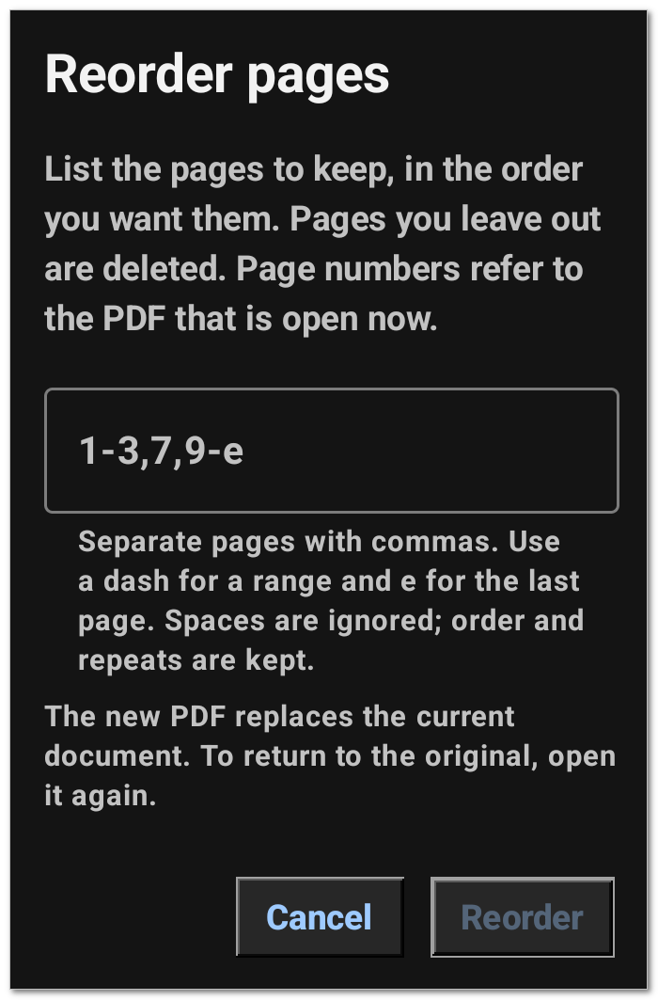

<hr/>

### set page size.
you can override the page size, to a range of pages,  
very helpful if you've got a non-standard size and you want to pre-normalize it's size before printing it,  
at least you'll see how it looks like. there isn't any explicit border or aspect-ratio keeping,  
so the size you'll enter is the size you'll get,  
at first it will try to populate the size from the actual page you are in,  
and you can set, and choose range of any page,  
you can choose from a standard size (ISO) for example A4, or type the length using a measurement-unit of your choice.

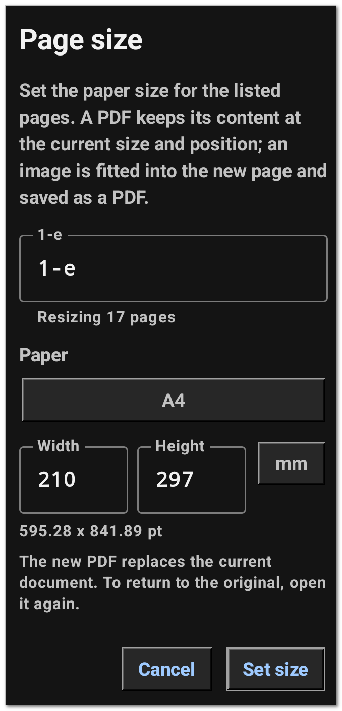

<hr/>

### normalize PDF

one of the biggest features in this app's PDF modification,  
using the `qPDF` lib, it can re-compress and truly linearize PDF,  
as well as try to generate somewhat compatible PDF/A-2b (it does not convert attachments).

except the JPEG re-compression, all of the features are loose-less and are set to the maximum possible,  
it means they are slow (compressing streams with maximum compression level), but you won't loose any details.  

you can safely enable all of those, they can save you few MB from the result file.

as this screen is quite large you can click the image below to see it full-size

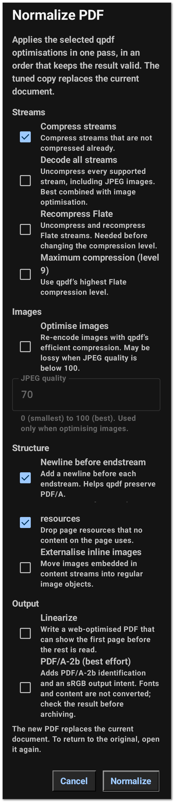


</details>

<hr/>

<details><summary><h2>📚 Formats supported</h2></summary>

| Format | Extension(s) | Definition | Key traits |
|--------|--------------|------------|------------|
| 📕 PDF (Portable Document Format) | `.pdf` | A fixed-layout format, created by Adobe, that preserves the exact look of a page, including fonts, images, and layout, on any device. | Best for scanned or designed documents. It reflows poorly on small e-reader screens, though newer readers handle it better. |
| 📘 EPUB | `.epub` | An open, reflowable ebook standard maintained by the IDPF. It is a ZIP container holding HTML, CSS, images, and metadata. | The most widely supported ebook format, and the one most publishers use. Text adapts to the screen, and readers can change fonts and sizes. |
| 📄 XPS / OXPS | `.xps`, `.oxps` | XML Paper Specification, a fixed-layout page format from Microsoft. It is a ZIP package of XML descriptions of each page. OpenXPS is the open version of the same idea. | Designed as a document-exchange format, similar in purpose to PDF. It is rarely used for books today. |
| 🦸 CBZ / CBT (comic book archive) | `.cbz`, `.cbt` | A comic archive: a ZIP (CBZ) or TAR (CBT) file containing the pages as image files (usually JPEG or PNG), named in reading order. | There is no text layer or reflow. Comic readers display the images in sequence, so the format is simple and easy to create. |
| 📖 FB2 (FictionBook) | `.fb2` | An XML-based ebook format, FictionBook 2.0, that describes a book's structure and metadata, such as title, author, and chapters, rather than its appearance. | Easy to process and index for collection management. It is common in some non-English markets, especially Russian-speaking ones, but has little support in English. |
| 📚 MOBI / PalmDoc | `.mobi`, `.prc`, `.pdb` | Older Amazon and Palm ebook containers, including the Mobipocket format that predates KF8 and AZW3. | Readable but reflowed without DRM support. Most modern Kindle books use AZW3/KFX, which MuPDF does not open. |
| 📝 Markdown | `.md`, `.markdown`, `.mdown`, `.mkd`, `.mkdn` | Plain text with lightweight heading, list, link and code syntax. | Reflows to the screen width. MuPDF converts it to HTML before layout; longer suffixes are handled through a temporary `.md` copy. |
| 🖼️ Images and PNM/PAM | `.png`, `.jpg`, `.jpeg`, `.gif`, `.bmp`, `.tif`, `.tiff`, `.jp2`, `.jpx`, `.jxr`, `.wdp`, `.hdp`, `.psd`, `.pnm`, `.pbm`, `.pgm`, `.ppm`, `.pam`, `.pfm`, `.jb2` | Single-page raster or vector images. PNM/PAM is a family of simple, uncompressed image formats. | Each image opens as a one-page document. SVG is handled as a vector page and stays sharp when zoomed. |
| 🌐 HTML, XHTML and SVG | `.html`, `.htm`, `.xhtml`, `.svg` | HTML is the web's markup language for text, links, and styling. SVG (Scalable Vector Graphics) is an XML format for vector images that scale without losing quality. | Standalone HTML is rarely used as an ebook because it splits across many files. HTML and SVG are mostly used inside EPUB files, where SVG can supply scalable illustrations or fixed-layout pages. |
| 📝 Plain text | `.txt`, `.text`, `.nfo`, `.log` | A file containing only characters, with no fonts, images, colours, or styling. .nfo files are text files, often with ASCII art, traditionally used to describe software or media releases. | The most portable format, readable on almost any device. The original ebooks, such as Project Gutenberg texts, were plain text. Line endings and character encoding (usually UTF-8) can cause display problems. |
| 🧾 Source, config and data | `.cfg`, `.ini`, `.conf`, `.properties`, `.yaml`, `.yml`, `.toml`, `.json`, `.jsonl`, `.csv`, `.tsv`, `.xml`, `.c`, `.h`, `.cpp`, `.hpp`, `.cs`, `.java`, `.kt`, `.js`, `.ts`, `.py`, `.rb`, `.go`, `.rs`, `.php`, `.sh`, `.bat`, `.ps1`, `.sql`, `.css` and similar | Text files written for a program rather than for a reader: configuration, structured data and source code. | Shown as reflowable plain text with the monospace toggle. MuPDF has no handler for these suffixes, so PDFr opens a temporary `.txt` copy; the copy is byte-for-byte identical and no byte-order mark is added. MuPDF's content detector still treats a file whose first line starts with `# ` as Markdown, so such a comment may render as a heading without the marker. A file with an entirely unknown suffix is also detected from its bytes and opened as text when MuPDF cannot handle it. |

💡 note: Fixed-layout documents are rasterised page by page. Reflowable documents
(EPUB, MOBI, FB2, Markdown, HTML and text) are laid out to the current screen
width. Plain text gets its own Compose view with line numbers, wrapping, RTL
alignment and a continuous or paged layout, so it can select across paragraphs
with the native text toolbar. Office files (DOCX/XLSX/PPTX/HWPX) are not
supported.

📄 PDFr advertises the `text/*` family plus the common application text types
(JSON, XML, YAML, TOML, JavaScript, shell, SQL and others) for **Open with** and
**Share**, so configuration and source files do not need a PDFr-specific entry
for each extension. The in-app picker also offers `text/*` and
`application/octet-stream`; text detection fills in providers that report no
useful MIME type.

</details>

<hr/>

<details><summary><h2>📥 How opening works</h2></summary>

📨 A document received from another app is usually a `content://` URI that only
PDFr can read. `DocumentStore` copies the bytes once into
`cacheDir/documents/<import-id>/`, using a staging file renamed into place only
after the copy succeeds. Everything else - the reader, the info dialog and the
share sheet - uses that cached file. `FileProvider` exposes only the
`documents/` tree.

🔄 Reordering, rotating, normalizing or fixing writes a new PDF into a
fresh subdirectory of the same cache, opens it, and then deletes the previous
copy.
There is deliberately no undo stack and no original PDF kept around: use the
**Open** toolbar button (or the system picker) to go back to the source file.
⚠️ Opening an encrypted PDF writes a decrypted cache copy (the source file is
untouched), and every rewrite saves without encryption, so the copy opens
without a password and without editing restrictions.

💾 **Save as** copies the document that is currently open to a location you
choose, using the same format and filename. The cached bytes are copied
verbatim, so rewrites, embedded metadata and the original date/time stay
intact wherever the target provider allows its timestamp to be updated.

</details>

<hr/>

<details><summary><h2>🌐🔡 multi-language support</h2></summary>

`PDFr` (through `MuPDF` rendering) supports opening and displaying many text encodings and languages,  
as for the `PDFr` application interface,  
I have a complete (machine) translation to 17 languages:

(ordered A-Z)

| Language code | Language name in English | Language name in its language |
|---|---|---|
| `ar` | Arabic | العربية |
| `de` | German | Deutsch |
| `en` | English | English |
| `en-GB` | English (United Kingdom) | English (United Kingdom) |
| `es` | Spanish | Español |
| `es-419` | Spanish (Latin America) | Español (Latinoamérica) |
| `fr` | French | Français |
| `fr-CA` | French (Canada) | Français canadien |
| `he` (actually `iw`)| Hebrew | עברית |
| `hi` | Hindi | हिन्दी |
| `ja` | Japanese | 日本語 |
| `ko` | Korean | 한국어 |
| `pt` | Portuguese | Português |
| `pt-BR` | Portuguese (Brazil) | Português do Brasil |
| `ru` | Russian | Русский |
| `zh-CN` | Chinese (Simplified) | 简体中文 |
| `zh-TW` | Chinese (Traditional) | 繁體中文 |

this can be changed through the language settings.
by default the value `system` would match your device's language (or fallback to `English`).

</details>

<hr/>

<details><summary><h2>✨ Features</h2></summary>

- 📂 **Open with / Share to PDFr**, or pick a file from the **Open** toolbar button.
- 💾 **Save as** next to **Open**: choose a destination and keep the current
  format, filename, extension and, where the provider supports it, the original
  modification time.
- ✂️ **Text selection and copying** - long-press a PDF page to open the page
  menu, then choose **Select all** to highlight every text block on that page
  and expose **Copy** and **Copy all**. Copy takes the current page's selection;
  Copy all extracts every page of the document. Plain text selects natively
  across paragraphs and shows the same two actions in its touch menu, including
  lines outside the viewport; line numbers are never included. There are no drag
  handles: PDF selection is intentionally page-wide for now.
- 📋 **Copy all** is also in the overflow menu, below the mirrored toolbar
  actions and above a divider: the entries below it only change how the
  document is shown.
- 🧭 **The overflow menu mirrors the toolbar first**: Share, Info, Open
  and Save appear in the same left-to-right order, disabled when no document is
  loaded (Open stays available). A divider separates them from the document
  actions that follow.
- 🔍 **Zoom** from 100% to 600% for fixed-layout documents with a two-finger
  pinch (any intermediate value) or a smooth double-tap glide (2x, 4x, 6x, back
  to 1x). The content resizes and pans under the fingers around the midpoint
  between them; the sharper bitmap arrives when the gesture ends. Reflowable
  documents disable pinch and double-tap: use **Text size** instead.
- 🔠 **Text size** from 5 to 40 pt (12 pt by default) for reflowable documents,
  from the overflow menu. It persists across files, rotation and process death
  and does not change the zoom of a PDF or image.
- 📑 **Plain-text layout options** - one continuous page (default on), line wrap
  (default on; horizontal scrolling when off), right-to-left direction and
  alignment (default off), line numbers on the left, or on the right in RTL
  (default on), and a monospace font override.
- 📍 **Page bar** sits permanently under the toolbar, for every format: first
  page, previous page, an editable page number with the total and a small jump
  button, next page and last page. The typed number is centred in its field,
  the total is one size larger and centred in its own slot, and the jump icon
  uses the normal text colour rather than the green accent. The bar follows the
  UI language by default, so it mirrors for Hebrew and Arabic while the toolbar
  above it stays left-to-right; **Settings… → Page bar direction** can force
  left-to-right or right-to-left instead. The page field follows scrolling and
  navigation even while it has focus, and a tap anywhere else in the reader
  commits the value and drops the keyboard. The buttons disable at the ends,
  and the bar never fades. The overflow menu, info editor and other dialogs
  scroll when needed and never cover more than three quarters of the screen.
- 🌐 **Hebrew and RTL** - the whole interface is translated, and the layout
  mirrors when the language is right-to-left. **Settings…** in the overflow menu
  switches between the system language and the languages shipped in this build,
  listed by English and native name without leaving the reader. Only the UI
  direction changes: PDF pages, images and plain text keep their own direction,
  and plain text still opens left-to-right unless **Align right** is turned on.
- 🎨 **Theme override** - the same **Settings…** dialog offers **Same as
  system**, **Light**, **Dark** (grey surfaces) and **AMOLED black** (pure black
  surfaces for OLED panels). A forced theme also updates the status and
  navigation bar icons.
- ♿ **Keyboard, mouse and TV** - toolbar buttons are square raised key caps
  with a light top lip and a dark bottom edge; menu entries, page-bar buttons
  and settings rows use the same look. A 36 dp cap sits inside the required
  48 dp touch target, so the key is about an icon plus a little padding instead
  of a large empty square. Buttons activate on pointer or key release, never on
  key-down, so the 130 ms press animation stays visible while a finger or remote
  key is held; focused or hovered buttons add a primary ring. Tab follows Share
  → Info → Open → Save → Menu and then the page bar in every language (the
  toolbar never mirrors; the page bar follows its direction setting). Android TV
  is supported through the leanback launcher entry and a 320x180 banner, and the
  dialogs scroll with a D-pad remote.
- 🔀 **Reorder pages** (PDF only): enter `1-3,7,9-e` to list the pages to keep, in
  the order you want them. Pages you leave out are deleted; `e` is the last
  page, spaces are ignored, and repeats are kept. PDFr writes a new,
  unencrypted PDF into its cache and opens it in place of the current document.
- 🔄 **Rotate 180°** (PDF only): turns the listed pages upside down. The range
  defaults to `1-e`, and only the pages you list are rotated.
- 📐 **Page size** (PDF and image): choose an ISO A, B or C sheet, or type an
  exact width and height in millimetres, centimetres, inches, points, CSS
  pixels or 12 pt `em`. The range defaults to `1-e`. PDF pages get a new
  MediaBox and CropBox without moving their content, so a larger sheet adds
  space and a smaller one crops the overflow; an image is fitted into the
  chosen page (aspect ratio preserved, centred) and written as a PDF. The new
  copy replaces the current document.
- 🧰 **Normalize** (PDF only): calls the bundled
  [qpdf](https://qpdf.readthedocs.io/) native library and applies the selected
  optimisations in one pass. Choose stream compression, decode-all/recompress
  Flate and compression level 9, image optimisation with a 0-100 JPEG quality,
  newline-before-endstream, unreferenced-resource removal, inline-image
  externalisation, linearization and best-effort PDF/A-2b identification. The
  tuned copy replaces the current document.
- 🩹 **Fix PDF** (PDF only, also offered when nothing is open): runs qpdf's
  repair cycle in-process - QDF form, fix-qdf stream/xref repair, then a normal
  rewrite - and opens the repaired copy. With no document open it opens the
  picker first and fixes the chosen PDF after it loads. The entry is absent for
  non-PDF documents.
- 🔤 **Monospace** override for plain-text documents, from the overflow menu.
- 🔐 **Password-protected documents** are unlocked once, then rewritten through
  qpdf into the private cache without a password and without editing
  restrictions. The original file is never changed; later rewrites, **Save as**
  and **Share** use the decrypted cache copy. If the opening password cannot
  lift the restrictions, the document stays readable and an optional **Remove
  restrictions** prompt asks for the owner password; cancelling keeps reading
  the restricted copy. Both password dialogs have a reveal button.
- ℹ️ **Metadata editor**: the **i** toolbar button opens the filename, extension, file
  created/modified timestamps and the document metadata the file already has.
  PDFs list every Info and XMP property; images list an ordered EXIF/XMP set
  (camera, lens, exposure, GPS, caption, keywords, creator, rights, rating,
  ICC profile) followed by any other EXIF, IPTC, PNG or XMP entries. Dates are
  shown as `yyyy-MM-ddThh:mm:ss` and can be typed or picked. Edits stay in a
  draft while the dialog is dismissed; **Apply** writes them into the file (or
  a sidecar for formats that cannot store them) and reloads. Clearing a field
  removes its value. JPEG, PNG and WebP metadata is written in place; HEIC,
  IPTC and ICC edits are read-only and stay beside the file.
- 📤 **Share** and 💾 **Save as** use the edited display name and timestamp, and
  PDF metadata changes are part of the bytes they copy.
- 🚪 **Exit** is always the last overflow entry, above a divider: it removes the
  task from recents and ends the PDFr process, so no reader or qpdf work is left
  running in the background.
- 📍 **Reading position** is preserved across rotation, reflow and process death.

</details>

<hr/>

<details><summary><h2>🏗️ Architecture</h2></summary>

```
app/src/main/java/com/karako/pdfr/
├── MainActivity.kt          # 🚪 intent intake (VIEW / SEND / picker)
├── data/
│   ├── DocumentFormats.kt   # 🏷️ MIME types, extensions and plain-text names
│   ├── DocumentInfo.kt      # 🧾 generic metadata model
│   ├── DocumentMetadata.kt  # ✏️ editable draft, PDF keys and sidecar overlay
│   ├── DocumentDates.kt     # 🕒 ISO/PDF date parsing and formatting
│   ├── MetadataSidecar.kt   # 🗂️ metadata for EPUB/image/text cache files
│   ├── MetadataTags.kt      # 🏷️ PDF Info, dictionary and XMP property names
│   ├── MuPdfConfig.kt       # ⚙️ layout/render limits, CSS and rewrite options
│   ├── PlainText.kt         # 📃 BOM-aware text decoding and line splitting
│   ├── DocumentStore.kt     # 💾 copies an incoming URI into cache
│   ├── StorageConfig.kt     # ⚙️ cache directory, name limits and sidecar names
│   ├── PageRanges.kt        # 🔢 parses "1-3,7,9-e" page selections
│   ├── AppSettings.kt       # ⚙️ stored theme/language/page direction + locale wrapping
│   ├── MuPdf.kt             # 🧵 one dedicated MuPDF thread
│   ├── MuPdfDocument.kt     # 📂 open/auth/layout/render/select/rewrite
│   ├── Qpdf.kt              # 🧵 one dedicated qpdf thread + JNI bridge
│   ├── QpdfConfig.kt        # ⚙️ qpdf library/thread/temp values + diagnostics
│   └── ShareSheet.kt        # 📤 ACTION_SEND via FileProvider
├── ui/
│   ├── ReaderApp.kt         # 🖥️ Compose continuous-scroll reader + dialogs
│   ├── ReaderViewModel.kt   # 🧠 reader state, viewport, selection, reflow
│   ├── ReaderConfig.kt      # ⚙️ reader timings, saved-state keys and colours
│   ├── PlainTextReader.kt   # 📃 continuous/paged text view with selection
│   ├── DocumentInfoDialog.kt# ✏️ editable metadata dialog
│   ├── TextSizeDialog.kt    # 🔠 reflowable text-size picker
│   ├── SettingsDialog.kt    # 🎨 theme, language and page-bar direction chooser
│   ├── AccessibleControls.kt# ♿ raised-key buttons and focus/hover rings
│   └── theme/Theme.kt       # 🎨 light, dark, AMOLED and dynamic palettes
app/src/main/cpp/            # 🔌 JNI bridge to static libqpdf
│   ├── qpdf_jni.cpp         # 🔌 JNI entry points and QDF repair
│   └── qpdf_config.h        # ⚙️ native qpdf options, PDF/A and ICC values
app/src/main/jniLibs/<abi>/  # 📦 stripped libqpdfjni.so per ABI
app/src/test/                # 🧪 JVM tests (no device, no native code)
app/src/androidTest/         # 🤖 MuPDF/qpdf integration tests + PDF writer
tools/make_test_files.js     # 🛠️ generates manual-test documents + Gutenberg books
tools/fetch-gutenberg.js    # 📚 standalone Project Gutenberg downloader
tools/                       # 🪟 Windows helpers: AVD, emulator, install, tests, gestures
```

🧵 MuPDF's native objects are not concurrency-safe, so every MuPDF call runs on a
single background thread (`MuPdf.dispatcher`). Pages are rendered into
`ARGB_8888` bitmaps held in a byte-sized LRU cache; structured text is cached
separately for selection.

🔗 qpdf is independent of MuPDF and can be slow on large files, so it has its own
serialized thread (`Qpdf.dispatcher`). It is built as a static library for each
Android ABI and exposed through a tiny JNI function
(`app/src/main/cpp/qpdf_jni.cpp`). The stripped `libqpdfjni.so` files are
checked into `app/src/main/jniLibs/`, so a normal Gradle build never needs the
qpdf or libjpeg sources.

</details>

<hr/>

<details><summary><h2>⚙️ Configuration</h2></summary>

Tunable values live in a handful of places, depending on who consumes them:

| What | Where | Why there |
| --- | --- | --- |
| User-visible text | `app/src/main/res/values/strings.xml` | Translatable, with plurals. Technical patterns such as the ISO date hint are marked `translatable="false"`. |
| Other languages | `app/src/main/res/values-*/strings.xml` | Thirteen full translations plus regional overlays. The settings picker and `xml/locales_config.xml` are generated from these folders by `buildSrc`, so adding a folder is enough. `values-iw` stays `iw` because that is Android's legacy qualifier for Hebrew, even though the generated tag is `he`. |
| Stored theme, language and page-bar direction | `data/AppSettings.kt` | The preference keys, the `PageDirection` enum and the locale wrapper. The language catalog itself comes from the generated `supported_language_tags` array. |
| Colours and theme | `app/src/main/res/values/colors.xml`, `themes.xml` | Standard Android resource lookup. |
| Semantic layout sizes | `app/src/main/res/values/dimens.xml` | Dialog heights, label columns, icon sizes and the selection outline. One-off spacing stays next to its composable. |
| Reader timing, layout limits, saved-state keys and selection colours | `ui/ReaderConfig.kt` | Shared by composables and the view model; mostly floats, durations and opaque keys. |
| qpdf bridge | `data/QpdfConfig.kt` and `app/src/main/cpp/qpdf_config.h` | Kotlin cannot read resources from the native thread, and the native header keeps option names, PDF/A identifiers, ICC values and diagnostics in one place. |

Other central homes worth knowing:

- `data/DocumentFormats.kt` - MIME types, extension sets, text-sample limits and text/image detection.
- `data/MetadataFields.kt` - stable metadata keys, source prefixes and the dialog schema.
- `data/MetadataTags.kt` - on-disk PDF Info keys, dictionary keys and XMP property names.
- `data/PdfMetadata.kt` / `data/ImageMetadata.kt` - PDF Info/XMP and EXIF/XMP slot mappings.
- `data/MuPdfConfig.kt` - cache budget, layout/render limits, CSS and rewrite options.
- `data/StorageConfig.kt` - cache directory, file-name limits, sidecar suffix and timestamp thresholds.
- `data/NormalizeOptions.kt` - Normalize defaults and JPEG-quality bounds.
- `data/TextSettings.kt` - text-size range and default.
- `data/AppSettings.kt` - stored theme/language, the offered languages and the locale wrapper.
- `ui/ZoomMath.kt` - zoom range and double-tap stops.

When changing a default, change it at its central home rather than at a call
site. `ReaderConfig`, `QpdfConfig`, `MuPdfConfig`, `StorageConfig`,
`NormalizeOptions`, `TextSettings` and the metadata objects are intentionally
plain Kotlin so unit tests can read them without an Android context.

</details>

<hr/>

<details><summary><h2>📦 Build</h2></summary>

- ☕ JDK 17
- 🤖 Android SDK 37
- 🐘 Gradle 9.8.2
- 🧩 The official prebuilt MuPDF AAR `com.artifex.mupdf:fitz:1.28.5` is resolved
  from `https://maven.ghostscript.com`.
- 🔧 qpdf 12.4.2 is linked statically; the stripped JNI libraries are committed,
  so the Android NDK is only needed when rebuilding them.

```bash
./gradlew assembleDebug
adb install -r build/app/outputs/apk/debug/app-universal-debug.apk
```

📁 Gradle writes this module's output to `build/app` (not `app/build`), so the
source tree stays free of generated files. Release APKs and AABs are also
copied to `build/release` after `assembleRelease` or `bundleRelease`.

📱 The build produces one APK per ABI plus a universal APK; use the matching
split for smaller installs (for example `app-x86_64-debug.apk` on an x86_64
emulator).

</details>

<hr/>

<details><summary><h2>🛠️ Rebuilding the qpdf bridge</h2></summary>

`build/qpdf/` holds the downloaded qpdf and libjpeg-turbo sources and the
per-ABI build trees. `tools/build-qpdf-android.js` configures and builds all
four ABIs with the Android NDK, strips the resulting `libqpdfjni.so`, and copies
it into `app/src/main/jniLibs/<abi>/`. Only do this when `qpdf_jni.cpp`,
`qpdf_config.h` or the qpdf version changes; a normal clone builds from the
checked-in libraries. `qpdf_config.h` holds the option strings, PDF/A
identifiers, ICC profile values and error text used by the bridge, so it is
edited alongside `qpdf_jni.cpp`, never inside the downloaded
`build/qpdf/src` tree.

</details>

<hr/>

<details><summary><h2>🧪 Testing</h2></summary>

Three layers, all runnable from the repository root:

| Layer | Command | Needs a device? |
| --- | --- | --- |
| 🧪 JVM unit tests | `tools\run-unit-tests.bat` (or `gradlew :app:testDebugUnitTest`) | ❌ no |
| 🤖 MuPDF integration tests | `tools\run-instrumented-tests.bat` | ✅ yes |
| 📋 Manual checklist | `tools\manual-testing.bat` | ✅ yes |

- 📄 `app/src/test/README.md` - `PageRanges`, `DocumentFormats`, `DocumentInfo`,
  dates, plain-text decoding and metadata sidecars.
- 📄 `app/src/androidTest/README.md` - opens, renders, selects, reorders,
  rotates, normalizes and repairs through qpdf, unlocks AES-256 PDFs, rewrites
  metadata and toggles plain-text monospace on real MuPDF. It also checks the
  accessibility tree (labels, 48dp targets, Tab order), the Hebrew toolbar, the
  leanback/banner manifest entries and every image-to-PDF conversion path.
- 📄 `tools/README.md` - AVD creation (phone and TV), emulator/install helpers,
  fixture pushing, the manual checklist, the raw-multitouch pinch helper, and
  the dependency-free fixture generator/Project Gutenberg downloader.

🚀 Typical first run:

```bat
tools\create-test-avd.bat
tools\start-emulator.bat
tools\install-debug.bat
tools\push-fixtures.bat
tools\run-instrumented-tests.bat
tools\manual-testing.bat
```

📺 Android TV checks use the same APK and a leanback AVD:

```bat
tools\create-tv-avd.bat
tools\start-emulator.bat pdfr_tv
tools\run-instrumented-tests.bat com.karako.pdfr.TvSupportInstrumentedTest
```

🧾 The instrumented tests generate their own PDFs at runtime (including a
password-protected one), so no test binaries are checked in. For manual
testing, `node tools\make_test_files.js` creates a 14-page `sample.pdf`, text
files (`.txt`, `.nfo`, `.text`), an EPUB, a CBZ, an AES-256 PDF whose password
is `secret`, and downloads a few public-domain Project Gutenberg books
(EPUB/TXT/HTML) into `gutenberg/`.

🧹 `build/` is disposable. Gradle regenerates the language array and
`xml/locales_config.xml` from the `values-*` folders on the next build, the
scripts create their own screenshot folders, and `reader-checks.bat` rebuilds
the few fixtures it opens (`sample.pdf`, `notes.txt`, `long.txt`) when a clean
has removed `build/test-fixtures`.

🔏 Release builds are minified and signed from `keystore.properties` in the project
root (git-ignored), or from environment variables for CI:

```properties
storeFile=keystore/release.jks
storePassword=…
keyAlias=alias
keyPassword=…
```

| Property | Environment variable |
| --- | --- |
| `storeFile` | `PDFR_STORE_FILE` |
| `storePassword` | `PDFR_STORE_PASSWORD` |
| `keyAlias` | `PDFR_KEY_ALIAS` |
| `keyPassword` | `PDFR_KEY_PASSWORD` |

⚠️ Without signing material Gradle still builds, but the release APK is signed
with the debug key. Back up the real keystore and its password: losing either
means future versions can no longer update an installed app.

📦 Release builds are size-optimised without obfuscation: R8 full mode,
resource shrinking, non-final resource IDs and the optimised resource
shrinker are enabled. `BuildConfig` is not generated for any variant because
nothing reads it. `-dontobfuscate` stays, so class, method and field names
remain readable in a decompiler; `Signature`, `InnerClasses`, `EnclosingMethod`,
`Exceptions`, `SourceFile` and `LineNumberTable` are kept for the same reason.
The R8 and shrinking settings are release-only, so debug builds are faster to
iterate on; they only add a little compile time, not runtime cost. On the arm64
APK they remove about 540 KB (~3.1%), almost all of it unused
`resources.arsc` entries.

</details>

<hr/>

<details><summary><h2>📏 Native size</h2></summary>
MuPDF is a real document engine, so the native library is the largest part of
the APK: roughly 11 MB for arm64-v8a, 8 MB for armeabi-v7a and 11 MB each for
the x86 ABIs. The qpdf JNI bridge adds about 3.1 MB per ABI after stripping.
The app ships ABI splits plus a universal APK, so users only need to install the
APK for their device.
</details>

<hr/>

<details><summary><h2>🔍🧑‍🔬 reverse-engineer friendly</h2></summary>

- I do not want or need to obfuscate or rename the classes since this is an opensource code, I want to make reverse engineering from APK to source easier for inspection.
- the pro-guard rules keeps generic signatures, nested-class links and checked exceptions in the dex, without these attributes a decompiler sees erased types and synthetic names, which makes the un-obfuscated build much harder to read. The cost is a few kilobytes, not runtime performance.
- keep source file names and line numbers so stack traces and decompiled output point back to the original Kotlin file. This is a deliberate readability trade-off, it allows easier crash diagnostics.

I don't chain github actions, directly to release,  
nor do I build on any market just yet,  
I build on my own PC then upload it manually when the list of changes is significant enough,  
so you don't really should trust the APK.

you can build it yourself, from source, you'll need the Android SDK, and NDK if you wish to rebuild the JNI bridge as well,  
or use a nice tool such as APKTool - https://github.com/iBotPeaches/Apktool/ (I use it all the time),  
to get a smalli and resources you can debug/inspect.

get a newer build of APKTool from:  

https://github.com/iBotPeaches/Apktool/actions/workflows/build.yml?query=is%3Asuccess+branch%3Amain+actor%3AiBotPeaches+event%3Apush

<hr/>

I would probably, eventually upload it to F-Droid, and Google App Store.

</details>

<hr/>

<details><summary><h2>🕵️ Checking That this App Has No Internet Access</h2></summary>

this app is provided with this file (`/app/src/main/res/xml/network_security_config.xml`):  

```xml
<?xml version="1.0" encoding="utf-8"?>
<network-security-config>
    <base-config cleartextTrafficPermitted="true">
        <trust-anchors>
            <certificates src="system" />
            <certificates src="user" />
        </trust-anchors>
    </base-config>
</network-security-config>
```

it allows you to use a packet inspection application,  
install its CA-certificate,  
and inspect any connection from this application (there should not be any),  
including HTTPS traffic (..should not be any).

one good choice is `Burp` suite, it is free and easy to set up.  
essentially it acts as a proxy, combined with trusting its CA-certificate,  
you'll be able to inspect pretty much everything this app does (shouldn't be anything..)

below are some generic set of instructions, to help you set it up.

<hr/>

## 🎯 What this guide is about

This guide shows you how to check whether an Android app sends any data over the internet. It uses **Burp Suite**, a free tool that acts as a proxy. The proxy sits between your device and the internet, so any network request the app makes passes through it and shows up in Burp's logs. You can use this to confirm an app is offline, or to see exactly what it tries to send.

⚠️ Burp Suite can only see traffic that goes through the proxy. Some apps ignore the device's proxy settings, so a clean Burp log is good evidence but not proof on its own. The final section covers a firewall step that closes that gap.

## 🧰 What you need

- 💻 A computer on the same Wi-Fi network as your Android device (or an Android emulator)
- 🐞 **Burp Suite Community Edition** (free), from the PortSwigger website
- 📱 The Android app you want to test (an APK or installed app)
- ☕ Java, if your version of Burp requires it

## 🟢 Step 1: Start Burp Suite

1. Open Burp Suite and create a temporary project.
2. Go to **Proxy > Proxy settings** (or **Proxy > Options**).
3. Confirm there is a listener on **127.0.0.1:8080** and that it is running.
4. Turn **Intercept** off so traffic is logged without pausing requests.

## 🌐 Step 2: Find your computer's IP address

- 🪟 **Windows:** run `ipconfig` in Command Prompt and note the IPv4 address under your Wi-Fi adapter.
- 🍎 **macOS:** open **System Settings > Wi-Fi > Details** and note the IP address.
- 🐧 **Linux:** run `ip addr` and note the address on your Wi-Fi interface.

## 📲 Step 3: Point the Android device at Burp

1. On the Android device, open **Settings > Network & internet > Internet** (the name varies by manufacturer).
2. Long-press your Wi-Fi network and choose **Modify network**.
3. Under **Proxy**, select **Manual**.
4. Enter your computer's IP address as the proxy hostname and **8080** as the port.
5. Save.

If you use an emulator, set the proxy in the emulator's Wi-Fi settings to your computer's IP address and port 8080.

## 🔐 Step 4: Install the Burp certificate (for HTTPS)

Without this step, Burp can see that HTTPS connections were attempted but cannot read their contents.

1. On the Android device, open a browser and go to **http://burp** (this only works while the proxy is set).
2. Download the **CA Certificate**.
3. Go to **Settings > Security > Encryption & credentials > Install a certificate > CA certificate** and install the file.

⚠️ Apps built for Android 7.0 and later usually ignore user-installed certificates unless their network security config allows them. If an app refuses the Burp certificate, Burp will log a failed TLS handshake for that connection. That failure is still useful evidence of an attempted connection.

## 🔎 Step 5: Run the app and check the logs

1. Open the app and use every feature you want to test, including login, settings, and any screens that load content.
2. In Burp, check these tabs:
   - 📜 **Proxy > HTTP history** lists every plain HTTP and decrypted HTTPS request.
   - 🔌 **Proxy > WebSockets history** lists any WebSocket traffic.
   - 🧾 **Dashboard > Event log** shows connection errors, including failed TLS handshakes.
3. 📝 Record any hostnames or IP addresses the app contacts.

**📊 Interpreting the results:**

- ✅ **No entries at all:** the app made no requests through the proxy. Continue to the firewall step to confirm.
- 🚨 **Entries present:** the app is connecting to the internet. Note the destinations and the data sent.
- ❌ **Only failed TLS entries:** the app attempted HTTPS connections that were rejected, which still means it tried to connect.

## 🛡️ Step 6: Confirm with a firewall (recommended)

Some apps ignore the system proxy or use direct sockets, so they would not appear in Burp. To block them outright:

1. 🧱 Install a per-app firewall. On Android, **NetGuard** works without root and uses a local VPN to block internet access per app.
2. 🚫 Block the target app's internet access (Wi-Fi and mobile data).
3. 🔁 Use the app again and check whether it still loads content or reports errors.
4. 📋 Watch the firewall's connection log, which records blocked attempts even when Burp shows nothing.

If the app works fully offline, it does not need the internet. If it fails to load anything or shows errors, it depends on the network.

## ⚠️ Limitations

- 🔍 Burp only sees traffic routed through the proxy.
- 📌 Apps with certificate pinning may refuse Burp's certificate, so their HTTPS content stays hidden.
- 🧭 A clean Burp log does not rule out network use by other means, such as DNS lookups or direct sockets. Use the firewall step to check.
- ✅ Use this only on apps and devices you own or have permission to test.

## 🧹 After testing

1. 📴 Remove the proxy from the Wi-Fi network settings.
2. 🗑️ Remove the Burp CA certificate from **Settings > Security > Encryption & credentials > User credentials**.
3. ⏹️ Stop Burp Suite and delete the temporary project if you no longer need the logs.

</details>

<hr/>

<details><summary><h2>⚖️ License</h2></summary>

📜 PDFr is licensed under the **GNU Affero General Public License v3.0**
(`LICENSE`). This is required because it links against MuPDF, which is also
AGPL-3.0 (or available under a commercial license from Artifex). If you
distribute a modified PDFr, the AGPL's source-offer obligations apply.

🔗 MuPDF: https://mupdf.com/ - Copyright Artifex Software, Inc.

🔗 qpdf: https://qpdf.readthedocs.io/ - Apache License 2.0, Copyright Jay
Berkenbilt and contributors. libjpeg-turbo: https://libjpeg-turbo.org/ -
IJG/BSD-style licenses. Both are linked statically into `libqpdfjni.so`.

</details>
